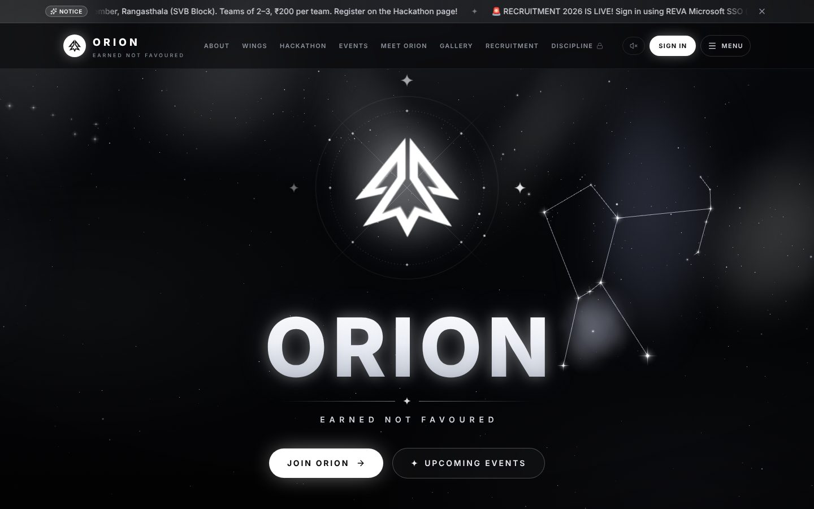

# ORION · REVA University

**Official website of Club ORION, REVA University, Bengaluru.** *Earned, not favoured.*

### 🌐 Live site: **[orion-club-website.vercel.app](https://orion-club-website.vercel.app)**

| | |
|---|---|
| 🚀 **Aarambh 2026 hackathon** | [orion-club-website.vercel.app/hackathon](https://orion-club-website.vercel.app/hackathon) · 12 Nov 2026 · Rangasthala, SVB Block |
| 📅 Events | [/events](https://orion-club-website.vercel.app/events) |
| 👥 Meet ORION | [/team](https://orion-club-website.vercel.app/team) |
| ✉️ Connect with ORION | [/contact](https://orion-club-website.vercel.app/contact) |
| 📸 Instagram | [@orionreva](https://www.instagram.com/orionreva/) |
| 💼 LinkedIn | [ORION REVA](https://www.linkedin.com/company/orionreva) |



---

## What's on the site

- **Home**: the ORION mark in a 3D star chart over a live WebGL constellation sky, a sliding notice bar, and four navigation cards (Meet ORION, Member Spotlight, Upcoming Events, Connect with ORION).
- **Aarambh 2026 hackathon**: event details, poster and partners, plus a step-by-step team registration (team lead → members → domain preferences → UPI payment with UTR → review). The committee verifies each payment and confirms the team.
- **The five wings**: Discipline, Internal & External, Cultural, Technical, and Media & Marketing, shown as a Constellation View and an Orbit Map that share one selection.
- **Events**: upcoming and past events, a page per event, registration with status lookup, and Razorpay checkout (ready, switched on once keys are added).
- **Meet ORION**: directory with hierarchy tiers, live search, wing filter and profiles.
- **Portals**: member dashboard, committee console (registrations with CSV export, spotlight, inbox, data tools) and the discipline console.
- **Extras**: an original "Orion's Belt" soundtrack (Web Audio) and a gyroscope 3D tilt on phones.

## Tech stack

| Part | Tools |
|---|---|
| Frontend | React 19, Vite, Tailwind CSS v4, framer-motion, three.js, react-router |
| Data & sign-in | Firebase Firestore and Firebase Auth (email + verification, @reva.edu.in only) |
| Server | Vercel serverless functions in [`api/`](api) (registration, Razorpay order/verify/webhook) |
| Security | [`firestore.rules`](firestore.rules): public read for site content, committee-only writes, registrations created only by the server |
| Hosting | Vercel |

Fonts: Sora (headings), DM Sans (body), Cormorant Garamond (accents), Montserrat (ORION wordmark).

## Run locally

```bash
npm install
npm run dev        # http://localhost:5173
npm run build      # production build in dist/
```

Without Firebase settings the site runs on built-in sample data, so you can explore every page offline.
The live Firebase web config is in `.env.production` (public values; access is controlled by `firestore.rules`).

## Deploying and settings

Everything about Firebase, Razorpay, Vercel environment variables, the first admin account and loading the starting data is in **[DEPLOY.md](DEPLOY.md)**.
Secrets (the Firebase service account and Razorpay secret keys) live only in Vercel's environment variables, never in this repo.

## Project layout

```
api/                  Vercel serverless functions (registrations, Razorpay)
src/pages/            Routed pages (home, hackathon, events, team, portals, …)
src/components/       Shared UI, hero, constellation background, forms
src/context/          Auth, data (Firestore sync) and sound
src/lib/              Firebase client, payments, roles, content and hackathon form config
public/               Logo, favicon, event poster and payment QR
firestore.rules       Database security rules
```

## Branches

- `main`: the released site.
- `dev`: where new work happens before it is merged into `main`.
- `stable-v1`: the saved first redesign; kept as a backup and never changed.

---

Built for Club ORION, REVA University · Rukmini Knowledge Park, Kattigenahalli, Yelahanka, Bengaluru 560064.
